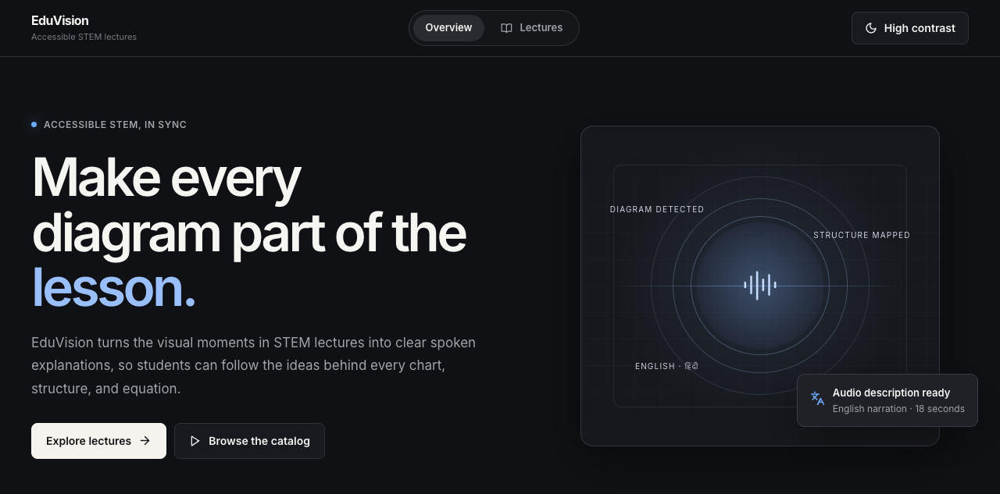
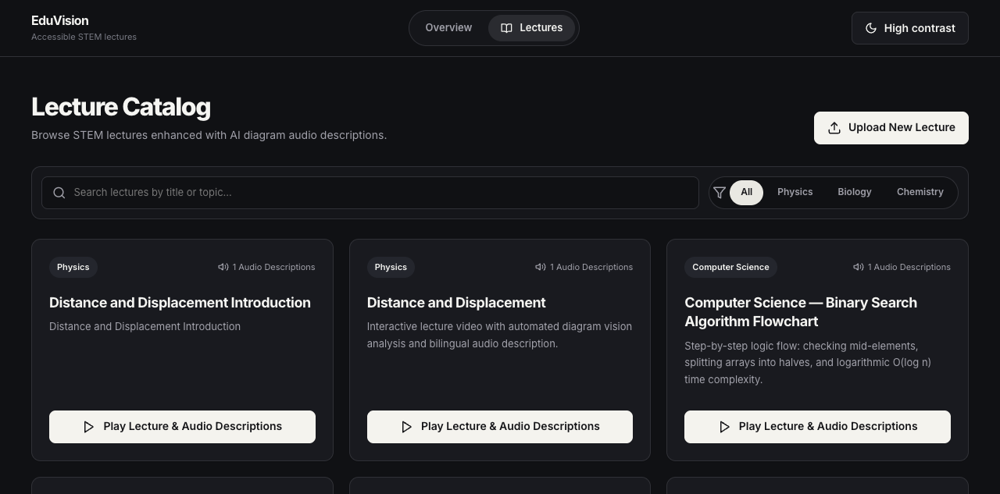
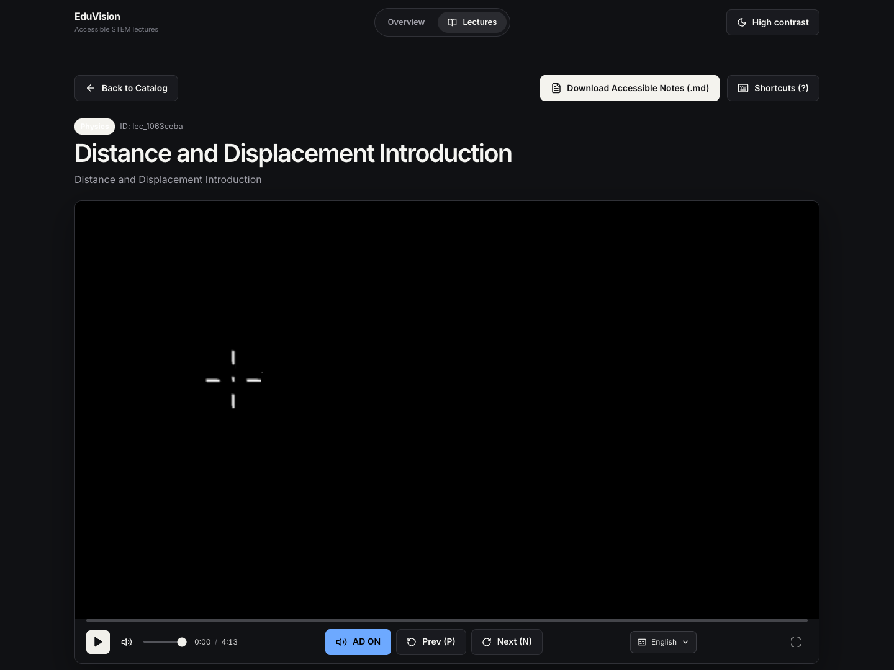
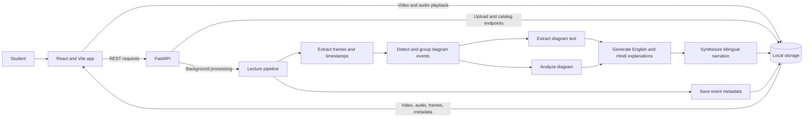
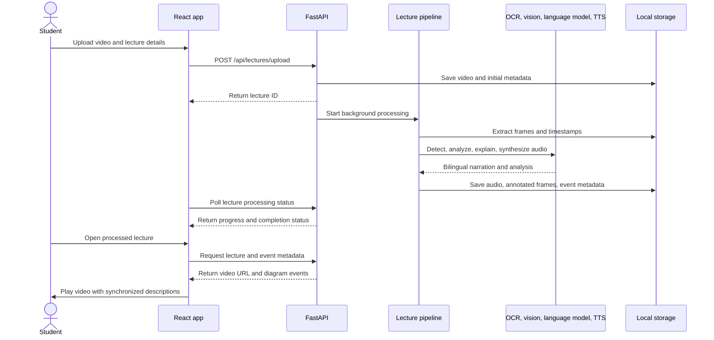

# EduVision

EduVision makes visual STEM content in lecture videos accessible through synchronized, bilingual audio descriptions. Upload a lecture, let the processing pipeline identify and explain diagram events, then watch with narration that pauses and resumes alongside the video.

## App screenshots

| Overview | Lecture catalog |
| --- | --- |
|  |  |

### Accessible lecture player



## What it does

- Detects diagram events in lecture videos and associates them with timestamps.
- Extracts diagram text with OCR and analyzes the visual structure with a vision model.
- Generates short educational explanations in English and Hindi, then synthesizes audio for both.
- Pauses lecture playback while an audio description plays, then resumes the lecture.
- Provides a searchable lecture catalog, upload progress, keyboard controls, accessible notes, and a high contrast option.

## How it fits together



### Lecture processing sequence



## Technology

- **Frontend:** React 18, Vite, Lucide icons, and CSS
- **Backend:** FastAPI and Uvicorn
- **Video analysis:** OpenCV, diagram detection, OCR, and vision-language models
- **Narration:** Language-model generated English and Hindi explanations, with gTTS/pyttsx3 speech synthesis
- **Storage:** Local files under `storage/` (runtime data is not committed)

## Run locally

### Requirements

- Python 3.9 or newer
- Node.js and npm
- A Groq API key for the vision and language-model pipeline
- Tesseract OCR is optional and can be installed on macOS with `brew install tesseract`

### Configure the backend

From the repository root:

```bash
python3 -m venv .venv
source .venv/bin/activate
pip install -r requirements.txt
cp .env.example .env
```

Add your key to `.env`:

```dotenv
GROQ_API_KEY=your_groq_api_key_here
```

Start the API:

```bash
python3 -m uvicorn backend.main:app --host 0.0.0.0 --port 8000 --reload
```

The interactive API docs are available at [http://localhost:8000/docs](http://localhost:8000/docs).

### Start the frontend

In a second terminal:

```bash
cd frontend
npm install
npm run dev
```

Open [http://localhost:3000](http://localhost:3000). Vite proxies `/api`, `/storage`, and `/static` requests to the backend at port 8000.

## Main API routes

| Method | Route | Purpose |
| --- | --- | --- |
| `GET` | `/api/lectures` | List processed lectures |
| `POST` | `/api/lectures/upload` | Upload a lecture video and start processing |
| `GET` | `/api/lectures/{id}` | Fetch lecture details |
| `GET` | `/api/lectures/{id}/metadata` | Fetch diagram event metadata |
| `GET` | `/api/lectures/{id}/status` | Check processing status |
| `GET` | `/api/lectures/{id}/export-notes` | Download accessible Markdown notes |
| `GET` | `/api/status` | Check API health and library counts |

## Repository map

```text
.
├── ai_pipeline/       # Video, detection, OCR, vision, explanation, and TTS stages
├── backend/           # FastAPI app, routes, storage, and pipeline orchestration
├── docs/screenshots/  # README screenshots
├── frontend/          # React and Vite app
├── scripts/           # Sample generation and demo data helpers
├── storage/           # Generated videos, frames, audio, and metadata
├── tests/             # Backend and pipeline tests
└── sample_diagrams/   # Example diagrams
```

## Notes

- Lecture uploads and generated pipeline outputs are stored locally in `storage/`.
- The lecture player currently provides audio description tracks in English and Hindi.
- `python3 scripts/seed_data.py` can populate demo lecture metadata for local development.
